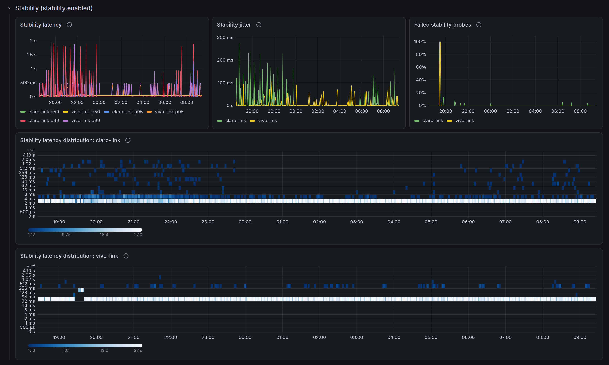

Trabalho de home office, então ficar sem internet é ficar sem trabalhar.
Por isso tenho duas conexões, uma da Claro e outra da Vivo. A redundância só
ajuda se eu souber como cada link está, então acompanho a velocidade e a
latência dos dois no Grafana.

Essas métricas vinham do
[speedtest-exporter](https://github.com/jansouza/speedtest-exporter), um
fork que mantenho do
[projeto do Miguel de Carvalho](https://github.com/MiguelNdeCarvalho/speedtest-exporter).
É um exporter em Python que chama a CLI oficial da Ookla e transforma o JSON
dela em métricas para o Prometheus, com uma instância para cada link.

No fim de outubro ele parou de medir.

## O limite da Ookla

A CLI da Ookla passou a sair com código 173 e a mensagem
`Limit reached: Too many requests received`, e o `speedtest_up` foi para
zero. Não encontrei anúncio oficial da Ookla sobre mudança de limite, mas
não fui o único. Na mesma semana apareceram relatos iguais no
[Speedtest Tracker](https://github.com/alexjustesen/speedtest-tracker/issues/2911)
e numa [integração do Home Assistant](https://github.com/soulripper13/hass-speedtest-ookla/issues/47),
com o problema começando por volta de 30 de outubro. O autor da issue do
Home Assistant estima que agora é preciso deixar de 20 a 30 minutos entre
um teste e outro, e que todo cliente do Speedtest no mesmo IP conta para o
mesmo limite.

Dava para contornar espaçando os testes, mas o monitoramento continuaria
dependendo de um binário fechado e da rede de servidores de uma empresa,
com regras que mudam sem aviso. Preferi ir atrás de algo open source.

## LibreSpeed

O [LibreSpeed](https://github.com/librespeed/speedtest) é um teste de
velocidade open source que roda no navegador e que qualquer um pode
hospedar. Não existe uma rede central de servidores como a da Ookla: cada
servidor é de quem o instalou. Algumas operadoras mantêm servidores
públicos. O link da Claro eu meço contra o servidor da Vivo, e o da Vivo
contra o servidor público de uma operadora local. Medir cada link no
servidor da própria operadora mascararia o resultado, porque o tráfego nem
sairia da rede dela. O projeto tem um cliente oficial de linha de comando, o [librespeed-cli](https://github.com/librespeed/speedtest-cli),
escrito em Go, que mede download, upload, ping e jitter e devolve o
resultado em JSON.

Faltava a parte do Prometheus, então escrevi o
[librespeed-exporter](https://github.com/jansouza/librespeed-exporter), em
Go, que roda o librespeed-cli num intervalo fixo e expõe o último resultado
em `/metrics`. A configuração mínima é a lista de servidores:

```yaml
servers:
  - name: home
    url: https://speed.example.com/
```

O `name` vira o label `server` nas métricas. Ele é escolhido por quem
configura e não muda quando a URL muda, o que evita quebrar a série.

## Teste agendado, não a cada scrape

O speedtest-exporter rodava o teste quando o Prometheus fazia scrape no
`/metrics`, com um cache opcional para não repetir o teste a cada coleta. É
um desenho simples, mas amarra o número de testes ao `scrape_interval` e
deixa o scrape lento, porque um teste leva de 30 a 40 segundos. Com um
limite de uso do outro lado, cache mal configurado vira teste a mais
contando contra o limite.

No librespeed-exporter o teste roda em segundo plano, por padrão a cada 30
minutos, e o `/metrics` só lê o último resultado. Um scrape nunca dispara
nem espera um teste.

Só roda um librespeed-cli por vez. Com vários servidores configurados, eles
são testados um depois do outro, porque dois testes simultâneos disputariam
o mesmo link e os dois resultados sairiam errados. Cada ciclo começa com
um atraso aleatório de até 10% do intervalo, para que vários exporters
ligados ao mesmo tempo não batam no mesmo servidor no mesmo segundo.

## Detalhes que mudam o número

Por padrão, o librespeed-cli mede a latência por ICMP e, se o ICMP falha
por falta de permissão ou por firewall, cai para HTTP sem avisar. Os dois
métodos dão números diferentes, e essa troca silenciosa misturaria os dois
na mesma série. O exporter usa `ping_method: http` por padrão e sempre mede
por HTTP.

As métricas seguem a convenção do Prometheus: velocidade em bytes por
segundo e latência em segundos. O speedtest-exporter expunha bits por
segundo e milissegundos, então quem migrar um dashboard precisa multiplicar
a velocidade por 8 (ou usar a unidade `bits/sec(SI)` do Grafana) e trocar a
unidade da latência.

Cada teste transfere de verdade o que mede. Num link de 500 Mbps, um
teste com os padrões (15 segundos de download e 15 de upload) baixa cerca
de 940 MB e sobe outros 940 MB. A cada 30 minutos, isso dá uns 90 GB por
dia por servidor. Em link com franquia, vale aumentar o `interval` ou
diminuir o `test.duration`. A métrica `librespeed_transferred_bytes_total`
mostra quanto o próprio exporter já consumiu.

## Teste de estabilidade

Um teste a cada 30 minutos não enxerga uma queda de dois minutos entre um e
outro. A interface web do LibreSpeed tem um teste de estabilidade, que
manda requisições pequenas e seguidas ao servidor e mede latência, jitter e
falhas, mas o librespeed-cli não tem esse modo. Como o teste web é só uma
sequência de `GET` no caminho de ping, o exporter faz isso ele mesmo quando
`stability.enabled` está ligado: uma requisição por segundo para cada
servidor, sem parar, com latência e jitter em histogramas.

A sondagem pausa enquanto o teste de velocidade roda, senão o link saturado
apareceria como um pico de latência a cada 30 minutos. Ela também vem
desligada por padrão, para ninguém começar a mandar requisição a um servidor público
sem ter pedido.



## Dashboard e alertas


Os prints são do lab do `deploy/compose`, com o servidor LibreSpeed rodando
na mesma máquina, por isso as velocidades na casa dos Gb/s.

O repositório traz um dashboard do Grafana com os últimos resultados por
servidor (com operadora e IP público, se `collect_client_info` estiver
ligado), download, upload, ping e jitter ao longo do tempo, taxa de
sucesso, dados consumidos por dia, a latência da sondagem de estabilidade
em percentis e heatmap, e uma marcação em todo gráfico onde um teste
falhou. Junto vêm regras de alerta para teste falhando, resultado velho,
download abaixo de um limite e falhas na sondagem de estabilidade.

Para ver tudo funcionando sem configurar nada, o `deploy/compose` sobe um
servidor LibreSpeed local, o exporter, o Prometheus com os alertas e o
Grafana com o dashboard:

```sh
cd deploy/compose
docker compose up -d --build
```

O Grafana fica em `http://127.0.0.1:3000`, com usuário e senha `admin`.

## Instalando

A imagem do contêiner já inclui o librespeed-cli e tem versões para
`linux/amd64`, `linux/arm64` e `linux/arm/v7`, o que cobre o Raspberry Pi:

```sh
docker run -d --name librespeed-exporter \
  -p 9469:9469 \
  -v "$PWD/config.yml:/etc/librespeed-exporter/config.yml:ro" \
  ghcr.io/jansouza/librespeed-exporter:0.2
```

Também há binários estáticos na
[página de releases](https://github.com/jansouza/librespeed-exporter/releases)
e uma unit do systemd em `deploy/systemd`. A referência completa de
configuração e métricas está no `docs/usage.md` do repositório. O código é
Apache 2.0, e o librespeed-cli que vai na imagem é LGPL-3.0.

## O que ainda falta

No roteador, faço um roteamento para que o teste de cada link saia pela sua
operadora. O que ainda não resolvi é o servidor do link da Vivo. Existem
poucos servidores públicos de LibreSpeed, e o da operadora local que uso
hoje não acompanha a velocidade contratada. A medição desse link fica
abaixo do contratado, e o número no dashboard mostra mais o limite do
servidor do que o do link. Até agora não achei outro servidor que seja bom,
perto de casa e com ping baixo. Sigo procurando e, quando achar, atualizo
este post.
