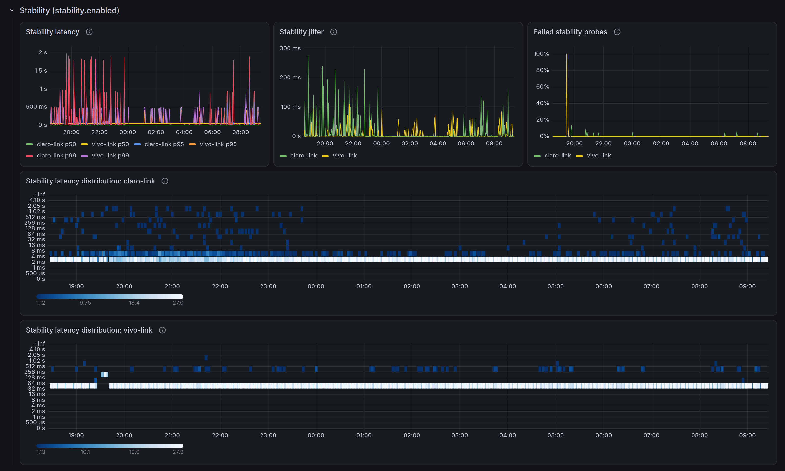
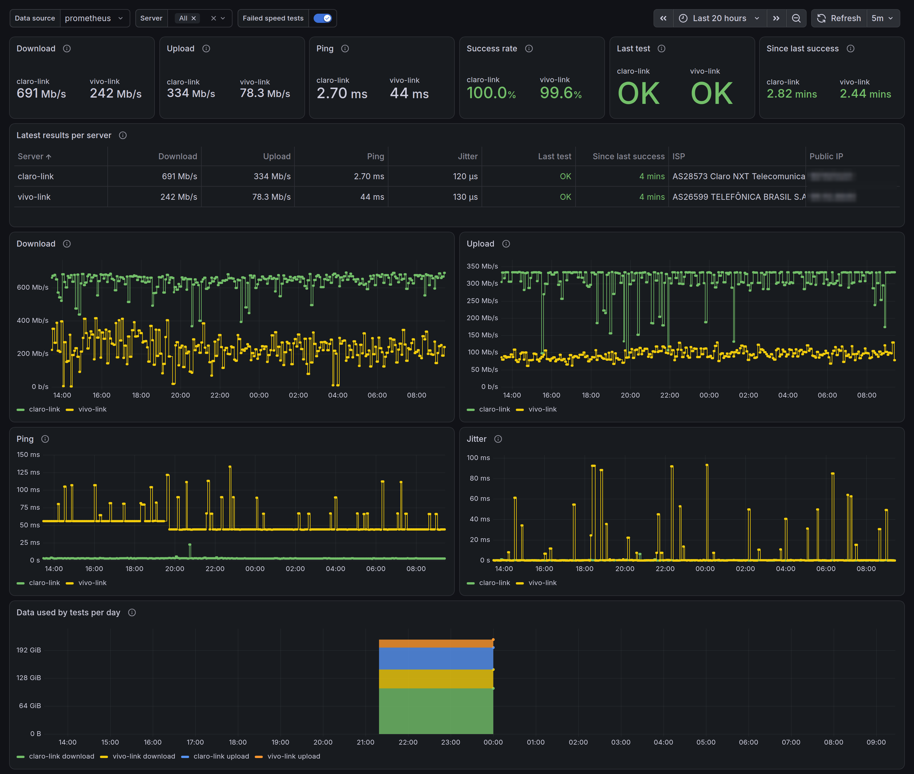

I work from home, so no internet means no work. That's why I have two
connections, one from Claro and one from Vivo (two of Brazil's largest
ISPs). Redundancy only helps if I know how each link is doing, so I track
the speed and latency of both in Grafana.

Those metrics came from
[speedtest-exporter](https://github.com/jansouza/speedtest-exporter), a
fork I maintain of
[Miguel de Carvalho's project](https://github.com/MiguelNdeCarvalho/speedtest-exporter).
It's a Python exporter that calls Ookla's official CLI and turns its JSON
into Prometheus metrics, with one instance per link.

At the end of October it stopped measuring.

## Ookla's limit

Ookla's CLI started exiting with code 173 and the message
`Limit reached: Too many requests received`, and `speedtest_up` dropped to
zero. I didn't find any official announcement from Ookla about a limit
change, but I wasn't the only one. The same week, identical reports showed
up in [Speedtest Tracker](https://github.com/alexjustesen/speedtest-tracker/issues/2911)
and in a [Home Assistant integration](https://github.com/soulripper13/hass-speedtest-ookla/issues/47),
with the problem starting around October 30. The author of the Home
Assistant issue estimates that you now need 20 to 30 minutes between tests,
and that every Speedtest client on the same IP counts toward the same
limit.

I could have worked around it by spacing out the tests, but my monitoring
would still depend on a closed binary and on one company's server network,
with rules that change without notice. I'd rather find something open
source.

## LibreSpeed

[LibreSpeed](https://github.com/librespeed/speedtest) is an open source
speed test that runs in the browser and that anyone can host. There's no
central server network like Ookla's: each server belongs to whoever
installed it. Some ISPs run public servers. I measure the Claro link
against Vivo's server, and the Vivo link against the public server of a
local ISP. Measuring each link against its own ISP's server would mask the
result, because the traffic wouldn't even leave that ISP's network. The
project has an official command line client,
[librespeed-cli](https://github.com/librespeed/speedtest-cli), written in
Go, which measures download, upload, ping and jitter and returns the result
as JSON.

The Prometheus part was missing, so I wrote
[librespeed-exporter](https://github.com/jansouza/librespeed-exporter), in
Go, which runs librespeed-cli on a fixed interval and exposes the latest
result on `/metrics`. The minimal configuration is the list of servers:

```yaml
servers:
  - name: home
    url: https://speed.example.com/
```

`name` becomes the `server` label on the metrics. Whoever configures it
picks it, and it stays the same when the URL changes, which keeps the
series from breaking.

## Scheduled tests, not one per scrape

speedtest-exporter ran the test when Prometheus scraped `/metrics`, with an
optional cache to avoid repeating the test on every scrape. It's a simple
design, but it ties the number of tests to `scrape_interval` and makes
scrapes slow, since a test takes 30 to 40 seconds. With a usage limit on
the other side, a poorly configured cache means extra tests counting
against that limit.

In librespeed-exporter the test runs in the background, every 30 minutes
by default, and `/metrics` only reads the latest result. A scrape never
triggers or waits for a test.

Only one librespeed-cli runs at a time. With several servers configured,
they're tested one after another, because two simultaneous tests would
compete for the same link and both results would be wrong. Each cycle
starts after a random delay of up to 10% of the interval, so several
exporters started at the same time don't hit the same server in the same
second.

## Details that change the number

By default, librespeed-cli measures latency over ICMP and, if ICMP fails
because of missing permissions or a firewall, falls back to HTTP without
telling you. The two methods give different numbers, and that silent switch
would mix both in the same series. The exporter defaults to
`ping_method: http` and always measures over HTTP.

The metrics follow the Prometheus convention: speed in bytes per second and
latency in seconds. speedtest-exporter exposed bits per second and
milliseconds, so anyone migrating a dashboard needs to multiply the speed
by 8 (or use Grafana's `bits/sec(SI)` unit) and change the latency unit.

Each test really transfers what it measures. On a 500 Mbps link, a
test with the defaults (15 seconds of download and 15 of upload) downloads
about 940 MB and uploads another 940 MB. Every 30 minutes, that adds up to
about 90 GB per day per server. On a metered link, it's worth increasing
`interval` or reducing `test.duration`. The
`librespeed_transferred_bytes_total` metric shows how much the exporter
itself has used.

## Stability test

A test every 30 minutes can't see a two-minute drop between one run and
the next. LibreSpeed's web UI has a stability test, which sends small
back-to-back requests to the server and measures latency, jitter and
failures, but librespeed-cli has no such mode. Since the web test is just a
sequence of `GET` requests to the ping path, the exporter does it itself
when `stability.enabled` is on: one request per second to each server,
continuously, with latency and jitter recorded in histograms.

Probing pauses while the speed test runs, otherwise the saturated link
would show up as a latency spike every 30 minutes. It's also off by
default, so nobody starts sending requests to a public server without
asking for it.



## Dashboard and alerts



The screenshots come from the `deploy/compose` lab, with the LibreSpeed
server running on the same machine, hence the speeds in the Gb/s range.

The repository includes a Grafana dashboard with the latest results per
server (with ISP and public IP, if `collect_client_info` is on), download,
upload, ping and jitter over time, success rate, data used per day, the
stability probe latency as percentiles and a heatmap, and a marker on
every chart where a test failed. It also comes with alert rules for failing
tests, stale results, download below a threshold and stability probe
failures.

To see everything working without configuring anything, `deploy/compose`
starts a local LibreSpeed server, the exporter, Prometheus with the alerts
and Grafana with the dashboard:

```sh
cd deploy/compose
docker compose up -d --build
```

Grafana is at `http://127.0.0.1:3000`, with user and password `admin`.

## Installing

The container image already includes librespeed-cli and has builds for
`linux/amd64`, `linux/arm64` and `linux/arm/v7`, which covers the
Raspberry Pi:

```sh
docker run -d --name librespeed-exporter \
  -p 9469:9469 \
  -v "$PWD/config.yml:/etc/librespeed-exporter/config.yml:ro" \
  ghcr.io/jansouza/librespeed-exporter:0.2
```

There are also static binaries on the
[releases page](https://github.com/jansouza/librespeed-exporter/releases)
and a systemd unit in `deploy/systemd`. The full configuration and metrics
reference is in the repository's `docs/usage.md`. The code is Apache 2.0,
and the librespeed-cli shipped in the image is LGPL-3.0.

## What's still missing

On my router, I route each link's test out through its own ISP. What I
haven't solved yet is the server for the Vivo link. There are few public
LibreSpeed servers, and the local ISP's server I use today can't keep up
with the contracted speed. That link measures below what I pay for, and the
number on the dashboard shows the server's limit more than the link's. So
far I haven't found another server that's good, close to home and with low
ping. I'm still looking and, when I find one, I'll update this post.
